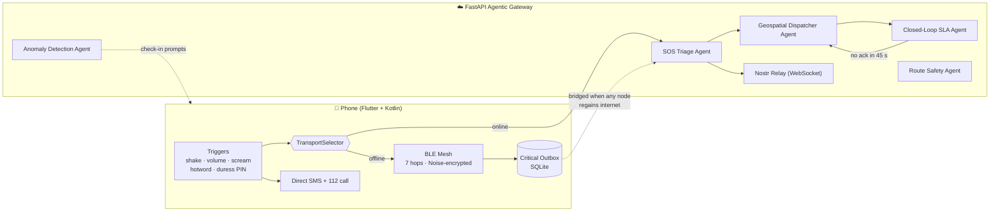

<div align="center">


# 🛡️ bSafe

### An offline-first, multi-agent personal safety platform for women

**Detect → Assess → Alert → Coordinate → Respond → Escalate → Resolve**

[](https://flutter.dev)
[](https://dart.dev)
[](https://kotlinlang.org)
[](https://fastapi.tiangolo.com)
[](https://firebase.google.com)
[](#-getting-started)

[🎥 Demo Video](https://youtu.be/gUbb2mIZKwU) · [📥 Download APK](https://bit.ly/3E1WP8a) · [🏗️ Architecture](#-architecture) · [🚀 Getting Started](#-getting-started)

</div>

---

## 📖 Overview

Most safety apps assume the one thing you may not have in an emergency: **a working internet connection and a free hand.**

**bSafe** is built around the opposite assumption. It can trigger an SOS **silently** (shake, volume buttons, a scream, a spoken word, or a disguised duress PIN), keep working **with no internet** by relaying distress beacons across nearby phones over a Bluetooth mesh, and hand the incident to a **closed-loop backend of cooperating agents** that triage it, find the nearest responders, and escalate automatically if nobody answers.

On top of emergency response, bSafe is also *preventive*: it scores routes and neighbourhoods for safety and lets the community **audit** places to keep those scores fresh.

<div align="center">

| 🤫 **Silent triggers** | 📡 **Works offline** | 🤖 **Agentic backend** | 🗺️ **Preventive intelligence** |
|:---:|:---:|:---:|:---:|
| Shake, volume combo, scream, hotword, duress PIN | 7-hop encrypted BLE mesh with SMS fallback | Triage, dispatch and SLA agents close the loop | Safe routes, area scores, crowd-sourced audits |

</div>

---

## 📱 Screenshots

> 💡 Add your own captures to a `docs/screenshots/` folder and swap the placeholders below.

<div align="center">

| Route Safety | Safety Audit | Emergency | BT Mesh |
|:---:|:---:|:---:|:---:|
| `docs/screenshots/route.png` | `docs/screenshots/audit.png` | `docs/screenshots/emergency.png` | `docs/screenshots/mesh.png` |

</div>

---

## ✨ Features

### 🚨 Multi-modal SOS: many ways to ask for help

| Trigger | How it works |
|---|---|
| **Manual SOS button** | Pulsing one-tap SOS on the home screen |
| **Shake-to-SOS** | Always-on accelerometer detector (> 2.4 g) running in a native Android foreground service, so it works with the screen off |
| **Volume-button combo** | `3× Volume Down + 1× Volume Up` fires a full SOS without opening the app |
| **Stealth key sequence** | `Vol Up → Vol Down → Vol Up` within 1.5 s fires a silent, haptic-confirmed alert |
| **Edge-AI scream detection** | Microphone monitors for ≥ 85 dB, then switches to on-device speech recognition for 8 s to catch hotwords |
| **Voice hotwords** | `help`, `bachao`, `save me`, `emergency`, `police`, `danger` |
| **Duress PIN** | A secondary PIN opens a convincing **"My Notes"** decoy app while silently raising a Tier 2 alert in the background |
| **Smart wake gesture** | Draw an "L" pattern to wake the SOS flow discreetly |
| **Anomaly timeout** | Missing a safety check-in during a journey escalates automatically |

When an SOS fires, bSafe dispatches **three channels at once**: direct background SMS to trusted contacts, the BLE mesh flood, and the agentic triage API.

**Voice-triggered safety check:** if a scream or hotword is detected, the app asks *"Are you safe?"* with a 5-second countdown. After **2 unanswered checks** it automatically sends an SMS and places a call to the helpline.

### 📡 Offline mesh SOS (BLE)
- **Dual-transport design**: automatically picks between `INTERNET_BRIDGE` and `BLE_MESH` as connectivity changes.
- **Up to 7 hops** of store-and-forward relaying between nearby phones.
- **Noise-protocol encrypted** packets with a compact binary wire format and fragmentation.
- **Persistent outbox** (`QUEUED → RELAYING → BRIDGED → DELIVERED / EXPIRED`) with 24-hour expiry, so alerts survive app restarts and are bridged to the internet the moment any node regains connectivity.
- **Cryptographic delivery receipts** acknowledge that help was reached.
- **Encrypted-SMS fallback**: location, trigger type and timestamp compressed into a 140-character Base64 payload.
- **Live peer count** and a nearby **distress inbox** so users can respond to someone else's alert.

### 🧭 Route Safety Finder
- Compare **Optimized Safest** vs **Fastest Direct** routes with a 0–10 safety rating.
- Considers lighting, footfall and crime risk, with a **Dynamic Night Mode** (9 PM – 6 AM).
- Driving and walking modes; live route journeys stream telemetry for anomaly monitoring.

### 🗺️ Neighbourhood Safety Scores (Nagpur)
- A standalone data pipeline turns crime/FIR records into a **0–100 Safety Score** for **63 localities**, rendered on a red → green map.
- Rule-based tiers (*Very Safe → Risky*) cross-checked against **unsupervised KMeans** clusters.
- See [`nagpur_safety_module/README.md`](nagpur_safety_module/README.md) for the full formula.

### 🏅 Community Safety Audits and Gamification
- Users audit a place on **9 parameters**: lighting, openness, visibility, crowd, security presence, walk path, public transport, gender diversity and overall feeling.
- Scores are **recency-weighted** (`weight = e^(−0.05 × age_days)`), with bonuses for photo and comment evidence.
- **Offline drafts** sync when the connection returns.
- Points, **7 levels** (*Explorer → Safety Hero*), **5 badges** (🌙 Night Owl, 📍 Neighbourhood Mapper, ⚡ First Responder, 🔥 Consistency Queen, 🔍 Detail Oriented), a leaderboard, and a **200 pts/day anti-abuse cap**.

### 👥 Contacts, Emergency Services and Self-Empowerment
- Tiered trusted contacts (`PRIMARY / SECONDARY / TERTIARY`) with OTP verification.
- One-tap call and directions for police, hospitals, ambulance, fire and safe places.
- Motivational quotes and self-defence reading material.

---

## 🏗️ Architecture



### 🤖 The agents

| Agent | Responsibility |
|---|---|
| **SOS Triage** | Classifies each payload as **Tier 1** (moderate) or **Tier 2** (extreme: ≥ 85 dB, duress PIN, or a distress hotword) and writes a human-readable triage summary |
| **Geospatial Dispatcher** | Finds verified responders (police, campus security, NGO volunteers, ambulance) within **1 km** (Tier 1) or **2.5 km** (Tier 2) and starts an automated **112 IVR bridge** for Tier 2 |
| **Closed-Loop SLA** | Tracks `OPEN → DISPATCHED → ACKNOWLEDGED → RESOLVED`. If no responder acknowledges within **45 s**, it widens the search to **5 km** and escalates. Checked every 10 s in the background |
| **Anomaly Detection** | Watches journey telemetry for sudden velocity drops and prolonged stops, then prompts the user to confirm they're safe |
| **Route Safety** | Scores a route 0–10 from lighting, footfall and crime risk, and proposes safer waypoints |

### 🔌 API reference

Interactive docs are served at **`/docs`** (Swagger) when the backend is running.

| Method | Endpoint | Purpose |
|---|---|---|
| `POST` | `/api/v1/auth/register` | Register a user with mandatory emergency contacts |
| `POST` | `/api/v1/journey/start` | Start a monitored journey and get a route safety score |
| `POST` | `/api/v1/journey/telemetry` | Stream location pings for anomaly detection |
| `POST` | `/api/v1/sos/trigger` | Multi-modal SOS ingestion → triage → dispatch |
| `POST` | `/api/v1/incidents/{id}/acknowledge` | Responder acknowledges an incident |
| `POST` | `/api/v1/mesh/relay` | Ingest a mesh-relayed SOS into the pipeline |
| `WS` | `/nostr/relay/subscribe` | Live stream of distress events |
| `POST` | `/safety/audits` · `/safety/audits/sync` | Submit and batch-sync safety audits |
| `GET` | `/safety/locations/nearby` · `/safety/locations/{id}` | Scored places and details |
| `POST` | `/safety/audits/{id}/upvote` | Upvote a helpful audit |
| `GET` | `/safety/leaderboard` · `/safety/users/{id}/profile` | Gamification data |

---

## 🧰 Tech Stack

| Layer | Technologies |
|---|---|
| **Mobile app** | Flutter, Dart, Google Fonts, `flutter_map`, `geolocator`, `noise_meter`, `speech_to_text`, `permission_handler`, `shared_preferences` |
| **Native Android** | Kotlin, foreground service, accelerometer, BLE (scan / advertise), SQLite outbox, method channels |
| **Backend** | Python, FastAPI, Pydantic, WebSockets, Uvicorn |
| **Data and ML** | pandas, NumPy, scikit-learn (KMeans), Leaflet |
| **Cloud** | Firebase (Core, Firestore) |
| **Protocols** | Noise (X25519), Nostr envelopes, custom binary mesh protocol |

---

## 🗂️ Project Structure

```text
bSafe/
├── lib/                          # Flutter app
│   ├── screens/                  #   home, SOS, BT mesh, safety audit, duress mask, …
│   ├── services/                 #   audio engine, shake/volume/hardware triggers, mesh, API clients
│   ├── widgets/                  #   SOS button, safety layers, leaderboard, contacts
│   ├── models/ · data/ · theme/
├── android/app/src/main/kotlin/  # Native layer
│   ├── com/bitchat/android/
│   │   ├── protocol/             #   binary protocol, compression, padding
│   │   ├── net/                  #   TransportSelector (internet ⇄ BLE)
│   │   ├── audit/                #   outbox + audit log (SQLite)
│   │   └── womensafety/          #   mesh SOS manager, shake detector, helpline bridge
│   └── com/example/safe/         #   MainActivity, SosForegroundService
├── backend/                      # FastAPI agentic gateway
│   ├── agents/                   #   triage · dispatcher · SLA · anomaly · route safety
│   ├── routes/                   #   auth, sos, journey, incidents, mesh, safety
│   ├── services/                 #   gamification, telephony (IVR), Nostr relay
│   ├── websocket/ · models.py · database.py
│   └── test_backend.py · test_safety.py · run_demo_simulation.py
├── nagpur_safety_module/         # Crime data → 0–100 safety score → map
└── test/                         # Flutter tests
```

---

## 🚀 Getting Started

### Prerequisites
- [Flutter SDK](https://docs.flutter.dev/get-started/install) (Dart `^3.6`)
- Android Studio and an Android device (BLE mesh, shake and volume triggers need real hardware)
- Python 3.10+ for the backend
- A [Firebase](https://console.firebase.google.com/) project

### 1 · Clone
```bash
git clone https://github.com/Mmayank-47/BSafe.git
cd BSafe
```

### 2 · Run the backend
```bash
python -m venv .venv && source .venv/bin/activate      # Windows: .venv\Scripts\activate
pip install fastapi "uvicorn[standard]" "pydantic[email]" httpx

uvicorn backend.main:app --host 0.0.0.0 --port 8000 --reload
```
Open **http://localhost:8000/docs** for the interactive API. On Windows you can use `run_backend.bat`, which also sets up `adb reverse` for a USB-connected phone.

**See it work end to end** (registration → journey → SOS triage → SLA → mesh relay):
```bash
python -m backend.run_demo_simulation
```

### 3 · Run the app
```bash
flutter pub get
flutter run
```

**Pointing the app at your backend.** The app defaults to `http://127.0.0.1:8000`.

- **USB phone:** run `adb reverse tcp:8000 tcp:8000`, or
- **Same Wi-Fi:** call `AgentApiService.setBaseUrl('http://<your-laptop-ip>:8000')`.

### 4 · Configure Firebase
1. Create a Firebase project and add an Android app with ID `com.example.safe`.
2. Replace `android/app/google-services.json` with your own.
3. Regenerate `lib/firebase_options.dart` with `flutterfire configure`.

### 5 · Build an APK
```bash
flutter build apk --release
```
Output: `build/app/outputs/flutter-apk/app-release.apk`

### 6 · (Optional) Regenerate Nagpur safety scores
```bash
cd nagpur_safety_module
pip install pandas numpy scikit-learn
python run_pipeline.py
```

### 🧪 Tests
```bash
python -m unittest backend.test_backend backend.test_safety   # backend
flutter test                                                  # app
```

---

## 🔐 Permissions

| Permission | Why bSafe needs it |
|---|---|
| Location | Attach your position to every SOS and power route/area scoring |
| Microphone | On-device scream and hotword detection |
| Bluetooth (scan / advertise / connect) | Offline mesh relaying |
| SMS and Phone | Send alerts and place the helpline call without opening the dialer |
| Foreground service, wake lock | Keep shake detection alive with the screen off |
| Notifications | Safety check-ins and incoming nearby distress alerts |

---

## 🚧 Project Status and Roadmap

bSafe is a **hackathon prototype**. This is what is real today and what is still simulated:

| Area | Status |
|---|---|
| Triggers (shake, volume, audio, duress), tiered contacts, safety audits, gamification | ✅ Implemented |
| BLE mesh, binary protocol, outbox, transport switching | ✅ Implemented (needs multi-device field testing) |
| Triage, dispatch and SLA agents, incident state machine | ✅ Implemented (in-memory store) |
| 112 IVR bridge, OTP delivery, Nostr broadcast | 🧪 Simulated (logs only; no live Twilio/Exotel/relay) |
| Route Safety Agent | 🧪 Uses baseline constants; PostGIS crime and lighting layers are the next step |
| Nagpur safety scores | 🧪 Computed from a **synthetic** dataset |

**Next up**
- [ ] Persistent storage (PostgreSQL + PostGIS) and a real responder registry
- [ ] Live telephony gateway for the 112 bridge and OTP verification
- [ ] Real crime and street-lighting data for routing
- [ ] iOS parity for the mesh and trigger layer
- [ ] Authentication, rate limiting, and a locked-down CORS policy

---

## 🤝 Team and Credits

bSafe is a **collaborative hackathon project**; the repository reflects the combined work of the team across mobile development, backend integration, location services, UI/UX, testing, and presentation.

The offline mesh layer is **inspired by and adapted from [bitchat](https://github.com/permissionlesstech/bitchat-android)**, the open-source Bluetooth mesh messenger. Please review its licence before redistributing.

---

<div align="center">

**Built with ❤️ so that help is always one gesture away.**

⭐ If bSafe resonates with you, consider starring the repo.

</div>
